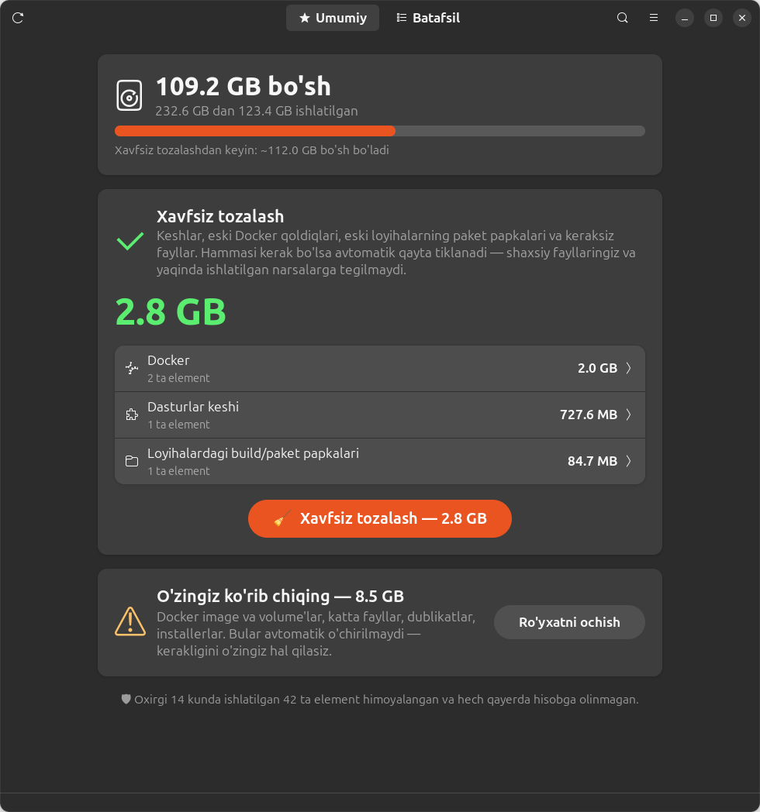

# 🧹 DevSweep

**Safe disk cleaner for Linux developers.** Finds Docker leftovers, caches, `node_modules`, duplicates and large files — and protects anything you used recently.

> 🇺🇿 Linux dasturchilari uchun xavfsiz disk tozalagich. Docker qoldiqlari, keshlar, `node_modules`, dublikat va katta fayllarni topadi. Yaqinda ishlatilgan narsalarga tegmaydi. Interfeys o'zbek tilida.



## Features

- **One-click safe clean** — removes only items that are regenerated automatically (caches, old build cache, old project dependencies). Nothing personal, nothing recent.
- **Review list** — everything else (Docker images/volumes, big files, duplicates, installers) is listed with a safety label so you decide item by item.
- **Recency protection** — anything used in the last 14 days is hidden and never selected in bulk:
  - containers: last start/stop time
  - images: created / last pulled or tagged
  - build cache: `LastUsedAt`
  - projects: last modification of project files
  - files: last access time (read with `O_NOATIME`, so scanning doesn't change it)
- **Running-app awareness** — caches of open apps (Chrome, Cursor, VS Code, Telegram) are skipped with a warning.
- **Real freed space** — measures `df` before and after cleaning.
- **Zero dependencies** — plain Python 3 + GTK4/libadwaita that ships with GNOME.

### What it finds

| Category | Examples | Label |
|---|---|---|
| Docker | dangling images, unused build cache, stopped containers, unused images & volumes | safe / review / careful |
| Caches | `~/.cache/*`, npm, yarn, pip, Gradle, Maven, Cargo, Go, Electron/VS Code caches | safe |
| Project artifacts | `node_modules`, `.next`, `.nuxt`, `.turbo`, `venv`, `target`, Gradle `build` | safe (old) / review |
| System (needs password) | disabled snap revisions, APT cache, journal logs | safe |
| Files | duplicates (content hash), 100 MB+ files, installers (`.deb`, `.apk`, `.iso`…), logs, temp files, partial downloads | review / careful |

### Safety rules

- Deletes only inside `$HOME` (system items go through `pkexec` with fixed commands).
- The UI/browser never sends paths — only IDs of items found by the scanner.
- Duplicates always keep one copy; files inside git repos are flagged as **careful**.
- Android SDK, `~/snap` app data and similar tool folders are skipped.
- Every delete shows a confirmation with the full list. Deletion is permanent (no trash).

## Requirements

- Linux (tested on Ubuntu 24.04 / GNOME)
- Python 3.10+
- For the desktop app: GTK 4 + libadwaita ≥ 1.5

```bash
sudo apt install python3-gi gir1.2-gtk-4.0 gir1.2-adw-1   # usually preinstalled on Ubuntu
```

## Usage

```bash
git clone https://github.com/aFeruz/devsweep.git
cd devsweep

python3 gui.py        # desktop app
./install.sh          # optional: add "Storage Cleaner" to the app menu

python3 cleaner.py    # alternative: browser UI at http://127.0.0.1:8765
```

### Shortcuts

| Key | Action |
|---|---|
| `Ctrl` + `+` / `-` / `0` | font size bigger / smaller / reset |
| `Ctrl` + `F` | search |
| `F5` | rescan |

### Options

```bash
RECENT_DAYS=30 python3 gui.py   # protect items used in the last 30 days (default 14)
BIG_FILE_MB=500 python3 gui.py  # "large file" threshold (default 100 MB)
PORT=9000 python3 cleaner.py    # browser UI port (default 8765)
```

## Project structure

```
cleaner.py   scanners, delete actions, browser UI (stdlib only)
gui.py       GTK4/libadwaita desktop app (uses cleaner.py)
install.sh   adds a .desktop entry to the app menu
```
