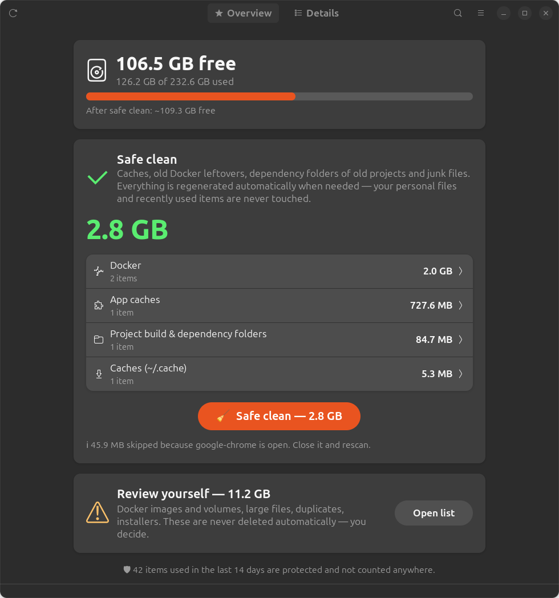

# 🧹 DevSweep

**English** · [Русский](README.ru.md) · [O'zbekcha](README.uz.md)

**Safe disk cleaner for Linux developers.** DevSweep finds Docker leftovers, caches, `node_modules`, duplicates and large files — and never touches anything you used recently.



## Features

- **One-click safe clean** — removes only things that are regenerated automatically: caches, old Docker build cache, dependency folders of old projects, junk files. Nothing personal, nothing recent.
- **Review list** — everything else (Docker images and volumes, large files, duplicates, installers) is listed with a safety label, and you pick item by item.
- **Recency protection** — anything used in the last 14 days is hidden and never selected in bulk:
  - containers — last start/stop time
  - images — created / last pulled or tagged
  - build cache — last used time
  - projects — last change of the project's files
  - files — last access time (read with `O_NOATIME`, so scanning itself doesn't change it)
- **Open apps are respected** — caches of running apps (Chrome, Cursor, VS Code, Telegram) are skipped with a warning.
- **Real numbers** — after cleaning, the freed space is measured on disk, not estimated.
- **3 languages** — English, Русский, O'zbekcha.
- **No dependencies** — plain Python 3 and GTK4/libadwaita that ship with GNOME.

### What it finds

| Category | Examples | Label |
|---|---|---|
| Docker | dangling images, unused build cache, stopped containers, unused images and volumes | safe / review / careful |
| Caches | `~/.cache/*`, npm, yarn, pip, Gradle, Maven, Cargo, Go, pnpm, bun, Electron/VS Code caches | safe |
| Project folders | `node_modules`, `.next`, `.nuxt`, `.turbo`, `.angular`, `venv`, `target`, Gradle `build` | safe (old) / review |
| System (password) | disabled snap revisions, APT cache, systemd journal | safe |
| Files | duplicates (by content), files over 100 MB, installers (`.deb`, `.apk`, `.iso`…), logs, temp files, incomplete downloads | review / careful |

**Labels:** 🟢 **safe** — regenerated automatically · 🟡 **review** — check before deleting · 🔴 **careful** — data may be lost.

### Safety rules

- Only paths inside your home folder are deleted. System items run fixed commands through `pkexec` (one password prompt).
- The UI never sends paths to the backend — only IDs of items the scanner found.
- Duplicates always keep one copy. Files inside git repositories are marked **careful**.
- Tool folders like the Android SDK and `~/snap` app data are skipped.
- Every deletion shows a confirmation with the full list. Deleted items do **not** go to the Trash.

## Installation

### 1. Requirements

- Linux with Python 3.10+
- Desktop app: GTK 4 and **libadwaita 1.5+** (Ubuntu 24.04+, Fedora 40+, Debian 13+, Arch)
- Optional: Docker (for Docker cleanup), polkit/`pkexec` (for system items)

Ubuntu usually has everything preinstalled. If not:

```bash
# Ubuntu / Debian
sudo apt install git python3 python3-gi gir1.2-gtk-4.0 gir1.2-adw-1

# Fedora
sudo dnf install git python3 python3-gobject gtk4 libadwaita

# Arch / Manjaro
sudo pacman -S git python python-gobject gtk4 libadwaita
```

### 2. Download

```bash
git clone https://github.com/aFeruz/devsweep.git ~/devsweep
cd ~/devsweep
```

### 3. Install into the app menu (optional, no root needed)

```bash
./install.sh
```

This adds **DevSweep** to the application menu and a `devsweep` terminal command (in `~/.local/bin`).

## Usage

| How | Command |
|---|---|
| App menu | press <kbd>Super</kbd>, type **DevSweep** |
| Terminal | `devsweep` or `python3 gui.py` |
| Browser UI (no GTK needed) | `devsweep --web` or `python3 cleaner.py` → http://127.0.0.1:8765 |

1. Wait for the scan (a few seconds to 1–2 minutes).
2. **Overview** tab → press **🧹 Safe clean** to remove all safe junk at once.
3. **Details** tab → review the rest and tick what you want to delete.

### Keyboard shortcuts

| Keys | Action |
|---|---|
| <kbd>Ctrl</kbd> + <kbd>+</kbd> / <kbd>-</kbd> / <kbd>0</kbd> | larger / smaller / default text size |
| <kbd>Ctrl</kbd> + <kbd>F</kbd> | search |
| <kbd>F5</kbd> or <kbd>Ctrl</kbd> + <kbd>R</kbd> | rescan |

### Language

The language follows your system (`LANG`). Change it in the ☰ menu → **Language** (saved), or for one run:

```bash
DEVSWEEP_LANG=ru devsweep    # en, ru, uz
```

### Options

```bash
RECENT_DAYS=30 devsweep        # protect items used in the last 30 days (default: 14)
BIG_FILE_MB=500 devsweep       # "large file" threshold (default: 100 MB)
PORT=9000 devsweep --web       # browser UI port (default: 8765)
```

## Update

```bash
cd ~/devsweep && git pull
```

## Uninstall

```bash
cd ~/devsweep && ./install.sh --uninstall
rm -rf ~/devsweep ~/.config/devsweep   # remove the program and its settings
```

## Troubleshooting

| Problem | Solution |
|---|---|
| `GTK 4 / libadwaita 1.5+ is required` | install the packages from step 1, or use the browser UI: `devsweep --web` |
| Docker section is missing | make sure Docker runs and your user can use it: `sudo usermod -aG docker $USER`, then log out and back in |
| System items fail | install polkit (`pkexec`); the password prompt must be confirmed |
| `devsweep: command not found` | add `~/.local/bin` to `PATH`, or run `python3 ~/devsweep/gui.py` |
| Port 8765 is busy | `PORT=9000 devsweep --web` |
| A cache is "skipped because the app is open" | close the app and rescan (<kbd>F5</kbd>) |

## Project structure

```
cleaner.py   scanners, delete actions, browser UI (Python standard library only)
gui.py       GTK4 / libadwaita desktop app
i18n.py      translations: English, Russian, Uzbek
install.sh   app menu entry + devsweep command (--uninstall to remove)
```

Adding a language: add a column to every entry in `T` in `i18n.py` and register the code in `LANGS`.

## License

[MIT](LICENSE) © aFeruz
