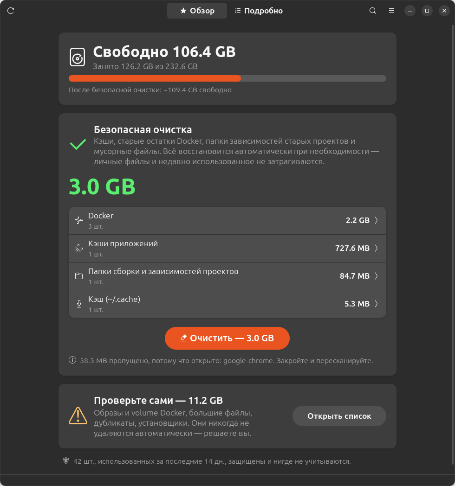

# DevSweep

[English](README.md) · **Русский** · [O'zbekcha](README.uz.md)

**Безопасная очистка диска для Linux-разработчиков.** DevSweep находит остатки Docker, кэши, `node_modules`, дубликаты и большие файлы — и никогда не трогает то, чем вы пользовались недавно.



## Возможности

- **Безопасная очистка в один клик** — удаляет только то, что восстанавливается автоматически: кэши, старый кэш сборки Docker, папки зависимостей старых проектов, мусорные файлы. Ничего личного и ничего недавнего.
- **Список для проверки** — всё остальное (образы и volume Docker, большие файлы, дубликаты, установщики) показано с меткой безопасности, и вы выбираете поштучно.
- **Защита недавнего** — всё, что использовалось за последние 14 дней, скрыто и никогда не выбирается массово:
  - контейнеры — время последнего запуска/остановки
  - образы — время создания / последнего pull или тега
  - кэш сборки — время последнего использования
  - проекты — последнее изменение файлов проекта
  - файлы — время последнего доступа (чтение с `O_NOATIME`, поэтому само сканирование его не меняет)
- **Учитываются открытые приложения** — кэши запущенных приложений (Chrome, Cursor, VS Code, Telegram) пропускаются с предупреждением.
- **Реальные цифры** — после очистки освобождённое место измеряется на диске, а не оценивается.
- **3 языка** — English, Русский, O'zbekcha.
- **Без зависимостей** — обычный Python 3 и GTK4/libadwaita, которые уже есть в GNOME.

### Что находит

| Категория | Примеры | Метка |
|---|---|---|
| Docker | безымянные образы, неиспользуемый кэш сборки, остановленные контейнеры, неиспользуемые образы и volume | безопасно / проверьте / осторожно |
| Кэши | `~/.cache/*`, npm, yarn, pip, Gradle, Maven, Cargo, Go, pnpm, bun, кэши Electron/VS Code | безопасно |
| Папки проектов | `node_modules`, `.next`, `.nuxt`, `.turbo`, `.angular`, `venv`, `target`, `build` Gradle | безопасно (старые) / проверьте |
| Система (пароль) | старые версии snap, кэш APT, журнал systemd | безопасно |
| Файлы | дубликаты (по содержимому), файлы больше 100 МБ, установщики (`.deb`, `.apk`, `.iso`…), логи, временные файлы, недокачанные загрузки | проверьте / осторожно |

**Метки:** **безопасно** — восстановится автоматически · **проверьте** — посмотрите перед удалением · **осторожно** — возможна потеря данных.

### Правила безопасности

- Удаляются только пути внутри домашней папки. Системные элементы выполняют фиксированные команды через `pkexec` (один запрос пароля).
- Интерфейс никогда не передаёт пути — только ID элементов, найденных сканером.
- У дубликатов всегда остаётся одна копия. Файлы внутри git-репозиториев помечаются как **осторожно**.
- Папки инструментов, например Android SDK и данные приложений `~/snap`, пропускаются.
- Перед каждым удалением показывается подтверждение с полным списком. Удалённое **не** попадает в корзину.

## Установка

### 1. Требования

- Linux с Python 3.10+
- Для приложения: GTK 4 и **libadwaita 1.5+** (Ubuntu 24.04+, Fedora 40+, Debian 13+, Arch)
- Необязательно: Docker (для очистки Docker), polkit/`pkexec` (для системных элементов)

В Ubuntu обычно всё уже установлено. Если нет:

```bash
# Ubuntu / Debian
sudo apt install git python3 python3-gi gir1.2-gtk-4.0 gir1.2-adw-1

# Fedora
sudo dnf install git python3 python3-gobject gtk4 libadwaita

# Arch / Manjaro
sudo pacman -S git python python-gobject gtk4 libadwaita
```

### 2. Скачать

```bash
git clone https://github.com/aFeruz/devsweep.git ~/devsweep
cd ~/devsweep
```

### 3. Добавить в меню приложений (необязательно, root не нужен)

```bash
./install.sh
```

Добавит **DevSweep** в меню приложений и команду `devsweep` в терминал (в `~/.local/bin`).

## Использование

| Как | Команда |
|---|---|
| Меню приложений | нажмите <kbd>Super</kbd>, введите **DevSweep** |
| Терминал | `devsweep` или `python3 gui.py` |
| Версия для браузера (без GTK) | `devsweep --web` или `python3 cleaner.py` → http://127.0.0.1:8765 |

1. Дождитесь окончания сканирования (от нескольких секунд до 1–2 минут).
2. Вкладка **Обзор** → нажмите **Очистить**, чтобы удалить весь безопасный мусор сразу.
3. Вкладка **Подробно** → просмотрите остальное и отметьте, что удалить.

### Горячие клавиши

| Клавиши | Действие |
|---|---|
| <kbd>Ctrl</kbd> + <kbd>+</kbd> / <kbd>-</kbd> / <kbd>0</kbd> | крупнее / мельче / стандартный размер текста |
| <kbd>Ctrl</kbd> + <kbd>F</kbd> | поиск |
| <kbd>F5</kbd> или <kbd>Ctrl</kbd> + <kbd>R</kbd> | пересканировать |

### Язык

Язык берётся из системы (`LANG`). Сменить можно в меню ☰ → **Язык** (сохраняется) или на один запуск:

```bash
DEVSWEEP_LANG=ru devsweep    # en, ru, uz
```

### Параметры

```bash
RECENT_DAYS=30 devsweep        # защищать использованное за последние 30 дней (по умолчанию 14)
BIG_FILE_MB=500 devsweep       # порог «большого файла» (по умолчанию 100 МБ)
PORT=9000 devsweep --web       # порт версии для браузера (по умолчанию 8765)
```

## Обновление

```bash
cd ~/devsweep && git pull
```

## Удаление

```bash
cd ~/devsweep && ./install.sh --uninstall
rm -rf ~/devsweep ~/.config/devsweep   # удалить программу и настройки
```

## Решение проблем

| Проблема | Решение |
|---|---|
| `GTK 4 / libadwaita 1.5+ is required` | установите пакеты из шага 1 или используйте версию для браузера: `devsweep --web` |
| Нет раздела Docker | убедитесь, что Docker запущен и доступен пользователю: `sudo usermod -aG docker $USER`, затем перезайдите в систему |
| Системные элементы не удаляются | установите polkit (`pkexec`) и подтвердите запрос пароля |
| `devsweep: command not found` | добавьте `~/.local/bin` в `PATH` или запускайте `python3 ~/devsweep/gui.py` |
| Порт 8765 занят | `PORT=9000 devsweep --web` |
| Кэш «пропущен, потому что приложение открыто» | закройте приложение и пересканируйте (<kbd>F5</kbd>) |

## Структура проекта

```
cleaner.py   сканеры, удаление, версия для браузера (только стандартная библиотека Python)
gui.py       приложение на GTK4 / libadwaita
i18n.py      переводы: английский, русский, узбекский
install.sh   пункт меню + команда devsweep (--uninstall для удаления)
```

Добавить язык: добавьте столбец в каждую запись `T` в `i18n.py` и код языка в `LANGS`.

## Лицензия

[MIT](LICENSE) © aFeruz
