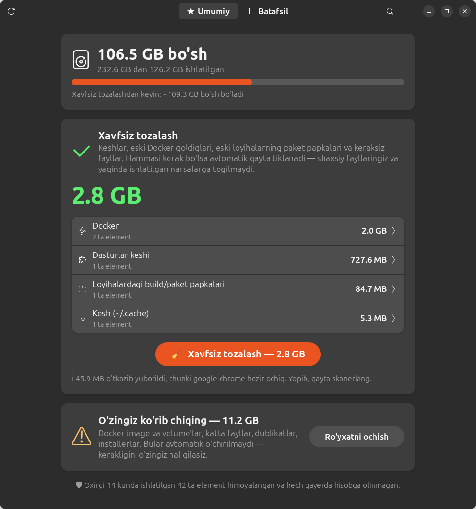

# 🧹 DevSweep

[English](README.md) · [Русский](README.ru.md) · **O'zbekcha**

**Linux dasturchilari uchun xavfsiz disk tozalagich.** DevSweep Docker qoldiqlari, keshlar, `node_modules`, dublikat va katta fayllarni topadi. Yaqinda ishlatgan narsalaringizga esa hech qachon tegmaydi.



## Imkoniyatlari

- **Bir tugmada xavfsiz tozalash.** Faqat avtomatik qayta tiklanadigan narsalarni o'chiradi: keshlar, eski Docker build cache, eski loyihalarning paket papkalari, keraksiz fayllar. Shaxsiy va yaqinda ishlatilgan narsalarga tegmaydi.
- **Ko'rib chiqish ro'yxati.** Qolgan hamma narsa (Docker image va volume'lar, katta fayllar, dublikatlar, installerlar) xavfsizlik belgisi bilan ko'rsatiladi, siz bittalab tanlaysiz.
- **Yaqinda ishlatilganlarni himoyalash.** Oxirgi 14 kunda ishlatilgan narsalar yashiriladi va ommaviy tanlovga hech qachon tushmaydi. Vaqt quyidagicha aniqlanadi:
  - konteynerlar: oxirgi ishga tushgan yoki to'xtagan vaqti;
  - image'lar: yaratilgan, oxirgi pull yoki tag qilingan vaqti;
  - build cache: oxirgi ishlatilgan vaqti;
  - loyihalar: loyiha fayllari oxirgi marta o'zgargan vaqt;
  - fayllar: oxirgi ochilgan vaqti. Fayl `O_NOATIME` bilan o'qiladi, shuning uchun skanerlashning o'zi bu vaqtni o'zgartirmaydi.
- **Ochiq dasturlar hisobga olinadi.** Ishlab turgan dasturlarning (Chrome, Cursor, VS Code, Telegram) keshi ogohlantirish bilan o'tkazib yuboriladi.
- **Haqiqiy raqamlar.** Tozalashdan keyin bo'shagan joy taxmin qilinmaydi, diskdan o'lchanadi.
- **3 til:** English, Русский, O'zbekcha.
- **Qo'shimcha kutubxonalarsiz.** Oddiy Python 3 va GNOME'da tayyor turadigan GTK4/libadwaita yetarli.

### Nimalarni topadi

| Bo'lim | Misollar | Belgi |
|---|---|---|
| Docker | nomsiz image'lar, ishlatilmagan build cache, to'xtatilgan konteynerlar, ishlatilmagan image va volume'lar | xavfsiz / ko'rib chiqing / ehtiyot bo'ling |
| Keshlar | `~/.cache/*`, npm, yarn, pip, Gradle, Maven, Cargo, Go, pnpm, bun, Electron/VS Code keshlari | xavfsiz |
| Loyiha papkalari | `node_modules`, `.next`, `.nuxt`, `.turbo`, `.angular`, `venv`, `target`, Gradle `build` | xavfsiz (eskilari) / ko'rib chiqing |
| Tizim (parol so'raydi) | eski snap versiyalari, APT keshi, systemd jurnali | xavfsiz |
| Fayllar | dublikatlar (tarkibi bo'yicha), 100 MB dan katta fayllar, installerlar (`.deb`, `.apk`, `.iso`…), loglar, vaqtinchalik fayllar, chala yuklanganlar | ko'rib chiqing / ehtiyot bo'ling |

**Belgilar:**
- 🟢 **xavfsiz**: avtomatik qayta tiklanadi;
- 🟡 **ko'rib chiqing**: o'chirishdan oldin tekshiring;
- 🔴 **ehtiyot bo'ling**: ma'lumot yo'qolishi mumkin.

### Xavfsizlik qoidalari

- Faqat uy papkangiz ichidagi narsalar o'chiriladi. Tizim elementlari `pkexec` orqali oldindan belgilangan buyruqlar bilan bajariladi, parol bir marta so'raladi.
- Interfeys backend'ga fayl yo'llarini emas, faqat skaner topgan elementlarning ID'larini yuboradi.
- Dublikatlarda har doim bitta nusxa qoladi. Git repozitoriyalari ichidagi fayllar **ehtiyot bo'ling** deb belgilanadi.
- Android SDK va `~/snap` ichidagi dastur ma'lumotlari kabi papkalar skanerlanmaydi.
- Har bir o'chirishdan oldin to'liq ro'yxat bilan tasdiqlash so'raladi. O'chirilgan narsalar savatchaga **tushmaydi**.

## O'rnatish

### 1. Talablar

- Python 3.10+ o'rnatilgan Linux.
- Desktop ilova uchun GTK 4 va **libadwaita 1.5+** kerak. Ular Ubuntu 24.04+, Fedora 40+, Debian 13+ va Arch'da bor.
- Ixtiyoriy: Docker (Docker'ni tozalash uchun) va polkit/`pkexec` (tizim elementlari uchun).

Ubuntu'da odatda hammasi o'rnatilgan bo'ladi. Agar yo'q bo'lsa:

```bash
# Ubuntu / Debian
sudo apt install git python3 python3-gi gir1.2-gtk-4.0 gir1.2-adw-1

# Fedora
sudo dnf install git python3 python3-gobject gtk4 libadwaita

# Arch / Manjaro
sudo pacman -S git python python-gobject gtk4 libadwaita
```

### 2. Yuklab olish

```bash
git clone https://github.com/aFeruz/devsweep.git ~/devsweep
cd ~/devsweep
```

### 3. Ilovalar menyusiga qo'shish (ixtiyoriy, root kerak emas)

```bash
./install.sh
```

Bu buyruq **DevSweep**ni ilovalar menyusiga qo'shadi va terminal uchun `devsweep` buyrug'ini yaratadi (`~/.local/bin` ichida).

## Foydalanish

| Qanday ochiladi | Buyruq |
|---|---|
| Ilovalar menyusi | <kbd>Super</kbd> tugmasini bosib, **DevSweep** deb yozing |
| Terminal | `devsweep` yoki `python3 gui.py` |
| Brauzer versiyasi (GTK kerak emas) | `devsweep --web` yoki `python3 cleaner.py` → http://127.0.0.1:8765 |

1. Skanerlash tugashini kuting. Bu bir necha soniyadan 1-2 daqiqagacha davom etadi.
2. **Umumiy** varaqda **🧹 Xavfsiz tozalash** tugmasini bosing. Barcha xavfsiz musor birdaniga o'chadi.
3. **Batafsil** varaqda qolganlarini ko'rib chiqing va o'chirmoqchi bo'lganlaringizni belgilang.

### Qisqa tugmalar

| Tugmalar | Vazifasi |
|---|---|
| <kbd>Ctrl</kbd> + <kbd>+</kbd> / <kbd>-</kbd> / <kbd>0</kbd> | yozuvni kattalashtirish / kichraytirish / standart o'lcham |
| <kbd>Ctrl</kbd> + <kbd>F</kbd> | qidirish |
| <kbd>F5</kbd> yoki <kbd>Ctrl</kbd> + <kbd>R</kbd> | qayta skanerlash |

### Til

Til tizim tilidan (`LANG`) olinadi. Uni ☰ menyu → **Til** orqali almashtirish mumkin, tanlovingiz saqlanadi. Faqat bitta ishga tushirish uchun:

```bash
DEVSWEEP_LANG=uz devsweep    # en, ru, uz
```

### Sozlamalar

```bash
RECENT_DAYS=30 devsweep        # oxirgi 30 kunda ishlatilganlarni himoyalash (standart: 14)
BIG_FILE_MB=500 devsweep       # "katta fayl" chegarasi (standart: 100 MB)
PORT=9000 devsweep --web       # brauzer versiyasi porti (standart: 8765)
```

## Yangilash

```bash
cd ~/devsweep && git pull
```

## O'chirib tashlash

```bash
cd ~/devsweep && ./install.sh --uninstall
rm -rf ~/devsweep ~/.config/devsweep   # dastur va sozlamalarni o'chirish
```

## Muammolarni hal qilish

| Muammo | Yechim |
|---|---|
| `GTK 4 / libadwaita 1.5+ is required` | 1-qadamdagi paketlarni o'rnating yoki brauzer versiyasidan foydalaning: `devsweep --web` |
| Docker bo'limi chiqmayapti | Docker ishlayotganini va foydalanuvchingizga ruxsat borligini tekshiring: `sudo usermod -aG docker $USER`, keyin tizimdan chiqib qayta kiring |
| Tizim elementlari o'chmayapti | polkit (`pkexec`) o'rnating va parol oynasini tasdiqlang |
| `devsweep: command not found` | `~/.local/bin` papkasini `PATH`ga qo'shing yoki `python3 ~/devsweep/gui.py` bilan ishga tushiring |
| 8765 port band | `PORT=9000 devsweep --web` |
| Kesh "dastur ochiq bo'lgani uchun o'tkazib yuborildi" | dasturni yoping va qayta skanerlang (<kbd>F5</kbd>) |

## Loyiha tuzilishi

```
cleaner.py   skanerlar, o'chirish, brauzer versiyasi (faqat Python standart kutubxonasi)
gui.py       GTK4 / libadwaita desktop ilova
i18n.py      tarjimalar: inglizcha, ruscha, o'zbekcha
install.sh   menyuga qo'shish + devsweep buyrug'i (--uninstall bilan olib tashlanadi)
```

Yangi til qo'shish uchun `i18n.py` faylidagi `T` lug'atining har bir yozuviga yangi ustun qo'shing va til kodini `LANGS`ga yozing.

## Litsenziya

[MIT](LICENSE) © aFeruz
